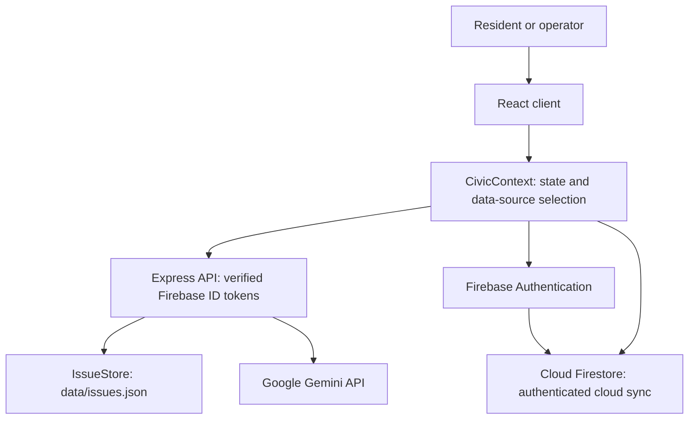

# CivicResolve

CivicResolve is a civic issue reporting and management prototype. Residents can report local infrastructure and public-service problems, follow their progress, and see which municipal team is responsible. Google Gemini can classify a report, estimate its urgency, summarize its public impact, and recommend a department. City operators can review reports and update their status.

## The problem

Reporting a pothole, overflowing bin, broken streetlight, water leak, or other neighborhood issue can be confusing. Residents may not know which department to contact or how to track a complaint. Municipal teams, in turn, need reports with enough structure to sort, prioritize, and route them.

CivicResolve brings reporting, AI-assisted triage, public tracking, and administrative review into one prototype. AI suggestions are intended to assist triage; they do not replace human review or emergency services.

## Features

- **Issue reporting:** Submit a title, description, location, optional category, reporter details, and an optional JPEG, PNG, WebP, or GIF image.
- **Gemini-assisted triage:** Analyze text and optional images to suggest a category, priority, urgency score, department, public-impact summary, response target, and next actions.
- **Description polishing:** Ask Gemini to make a report clearer while preserving the provided details.
- **Issue tracking:** Browse and search issues, filter by status, priority, category, or department, inspect status history, and view issue details.
- **Operations dashboard:** Review reports, change status and priority, assign departments or crews, add notes, and re-run AI analysis.
- **Map and ward views:** Explore reports by ward and priority. Coordinates are generated from the report location for this prototype; they are not geocoded addresses.
- **Community updates:** Endorse reports, add work-log comments, and register an SMS subscription. SMS delivery is not integrated.
- **AI assistant:** Use role-based civic chat for resident guidance, dispatch support, or field-safety checklists, with optional streamed responses.
- **CSV export and metrics:** Review issue counts and export filtered reports.
- **Accessibility support:** Includes keyboard focus management, live announcements, and a skip link.

## Tech stack

| Area | Technologies |
| --- | --- |
| Frontend | React 19, TypeScript, Vite |
| Styling and UI | Tailwind CSS 4, Motion, Lucide React |
| Server and API | Node.js, Express 4, `tsx` |
| AI | Google Gemini through the `@google/genai` SDK |
| Local issue storage | JSON file at `data/issues.json` |
| Authentication and cloud data | Firebase Authentication and Cloud Firestore |

## System design



The browser uses the Express API for Gemini requests and public issue reads. Mutating API and AI routes require a verified Firebase ID token; administrative mutations also require the signed `admin` custom claim. The client can use Firestore listeners and writes after Google sign-in. Signed-out users can browse public reports but cannot submit, comment, endorse, or use AI features. The local JSON store initializes from `server/store/seedData.ts` when its data file does not exist. Reporter contact details are kept separately from public issue records.

## Project structure

```text
.
├── data/
│   └── issues.json                 # Local JSON-backed issue data
├── server.ts                       # Express server and Vite development middleware
├── server/
│   ├── auth.ts                    # Firebase ID-token verification and API authorization
│   ├── routes/
│   │   └── issues.ts               # Issue, export, and AI API routes
│   ├── services/
│   │   ├── geminiClassifier.ts     # Gemini triage and description polishing
│   │   └── geminiChat.ts           # Gemini chat and streaming
│   └── store/
│       ├── issueStore.ts           # Local persistence and issue mutations
│       └── seedData.ts             # Initial prototype reports
├── src/
│   ├── a11y/                       # Accessibility primitives and announcements
│   ├── components/                 # Forms, tracker, map, admin, and AI views
│   ├── context/
│   │   └── CivicContext.tsx        # Shared app state and storage coordination
│   ├── hooks/                      # Form and admin action hooks
│   ├── services/
│   │   ├── civicApi.ts             # Browser client for the Express API
│   │   └── firestoreIssues.ts      # Firebase/Firestore operations
│   └── shared/
│       ├── civicDomain.ts          # Issue rules, validation, filtering, and stats
│       ├── chatDomain.ts           # Chat validation and prompt/context helpers
│       └── types.ts                # Shared application types and enums
├── firestore.rules                 # Firestore security rules
├── firebase-applet-config.json     # Firebase client configuration
└── package.json
```

## Getting started

### Prerequisites

- Node.js and npm
- Firebase project configured for Google sign-in and Cloud Firestore
- A Google Gemini API key to use AI triage, polishing, and chat

### Install and run

1. Install dependencies:

   ```bash
   npm install
   ```

2. Copy `.env.example` to `.env` and set `GEMINI_API_KEY`:

   ```dotenv
   GEMINI_API_KEY=your_gemini_api_key
   ```

   The key is read by the server and should not be added to client-side code or committed to source control. `APP_URL` is only needed when the hosting environment uses it.

3. Start the app:

   ```bash
   npm run dev
   ```

4. Open [http://localhost:3000](http://localhost:3000).

Without a Gemini key, signed-in users can submit manual reports, but Gemini-powered features will return a configuration error.

### Firebase cloud sync

Configure `firebase-applet-config.json` with your Firebase web app settings, enable Google Authentication, configure Firestore, and deploy the rules in `firestore.rules`. Verified Google sign-in is required for submissions and all AI or write operations. Administrative API routes require a Firebase custom claim named `admin: true`; set that claim only from a trusted server using the Firebase Admin SDK. Do not put service-account credentials in this repository or browser code. Firebase web-app configuration is client-side configuration, not an admin secret; restrict its API key to the intended Firebase services and domains in Google Cloud.

## Development commands

| Command | Description |
| --- | --- |
| `npm run dev` | Start Express with Vite development middleware on port 3000 by default. |
| `npm run build` | Create the production frontend bundle in `dist/`. |
| `npm start` | Start the server in production mode; build the frontend first. |
| `npm run preview` | Preview the Vite production bundle. |
| `npm run lint` | Run the TypeScript compiler without emitting files. |
| `npm test` | Run the focused Node test suite. |

Set `PORT` to change the server port. The production server serves `dist/` when `NODE_ENV=production`.

## API

All routes are served by the Express app under `/api`.

| Method | Route | Purpose |
| --- | --- | --- |
| `GET` | `/api/health` | Check API availability and whether a Gemini key is configured. |
| `POST` | `/api/ai/analyze` | Analyze a report with Gemini (verified sign-in required). |
| `POST` | `/api/ai/polish` | Polish a report description with Gemini (verified sign-in required). |
| `POST` | `/api/ai/chat` | Send a civic assistant message (verified sign-in required). |
| `POST` | `/api/ai/chat/stream` | Stream a civic assistant response using server-sent events (verified sign-in required). |
| `GET` | `/api/issues` | List reports; supports search, status, priority, category, department, and sort filters. |
| `GET` | `/api/issues/stats` | Get issue dashboard statistics. |
| `GET` | `/api/issues/export` | Download filtered reports as CSV. |
| `GET` | `/api/issues/:id` | Get a report by ID or tracking code. |
| `POST` | `/api/issues` | Create a report; verified sign-in required and AI classification runs on the server by default. |
| `PATCH` | `/api/issues/:id` | Update a report (administrator claim required). |
| `DELETE` | `/api/issues/:id` | Delete a report (administrator claim required). |
| `POST` | `/api/issues/:id/endorse` | Increase or decrease the report's endorsement count (verified sign-in required). |
| `POST` | `/api/issues/:id/comments` | Add a work-log comment; the server derives the author identity from the token. |
| `POST` | `/api/issues/:id/subscribe-sms` | Register a subscription count (verified sign-in required); this does not send SMS messages. |
| `POST` | `/api/issues/:id/reanalyze` | Re-run Gemini triage (administrator claim required). |

## Data structures and algorithms

- **Arrays:** Hold report lists, comments, status history, chat turns, and recommended actions.
- **Filtering:** Search and filter reports with array traversal, `O(n)` for `n` reports.
- **Sorting:** Sort filtered reports by time, priority, or update time, typically `O(n log n)`.
- **Maps:** Aggregate counts by ward, department, and category; grouping and counting are linear in the number of reports.
- **Single-pass statistics:** Compute status totals, priority totals, urgent counts, and resolution metrics in `O(n)`.
- **Serialized write queue:** The local JSON store queues mutations so concurrent writes are persisted in sequence.
- **Deterministic location hash:** A small polynomial string hash derives stable illustrative map coordinates from a ward and location. It is not a geocoding algorithm.
- **Tracking codes and IDs:** Sequential tracking codes are generated for readable reference; UUIDs identify local reports and history entries.

## Notes and limitations

- This is a functional prototype, not a production municipal case-management system.
- Gemini output is a recommendation and may be incorrect; staff should verify classification and urgency.
- The default Express issue store is a local JSON file and is not suitable for multi-instance production deployment.
- The Express API uses an in-memory Firebase signing-key cache and requires internet access to refresh it.
- Existing Firestore issue documents created by older versions may still contain `reporterDisplay`; redact that field from existing public documents before production use.
- Configure at least one trusted administrator custom claim before using admin-only API routes.
- Add distributed rate limiting, monitoring and alerting, abuse controls, and a production database before public deployment.
- The map uses generated coordinates, not a mapping or geocoding provider.
- The SMS endpoint records a subscription but has no SMS gateway integration.
- Review data retention, deletion/export workflows, privacy notices, Firebase API-key restrictions, and production storage before deploying with real resident data.
